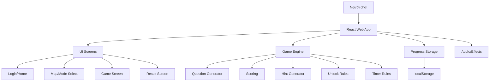
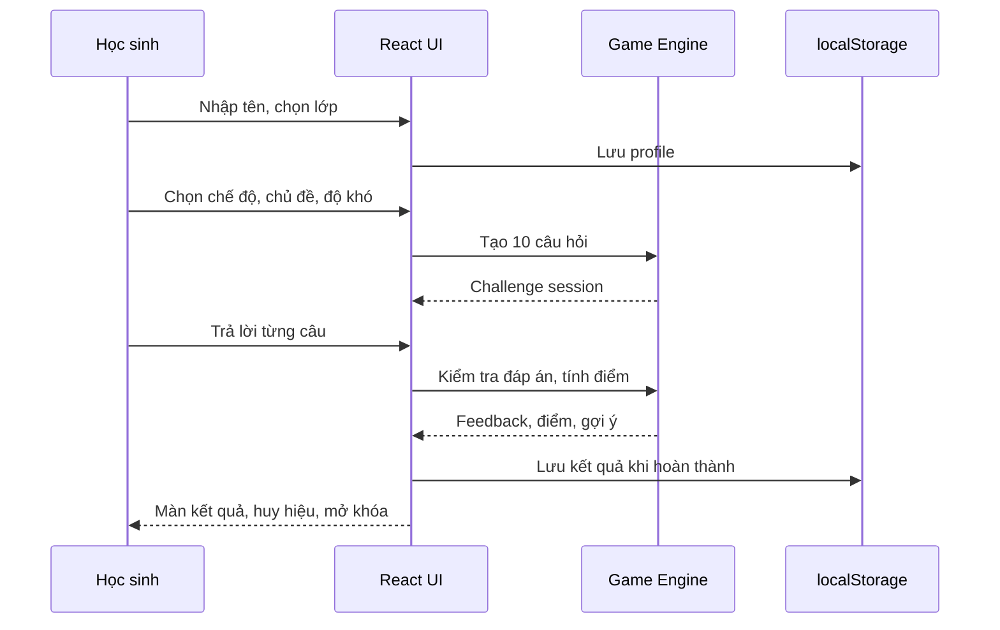

# Thiết Kế Hệ Thống - Cú Mèo Toán Học

## 1. Mục tiêu hệ thống

`Cú Mèo Toán Học` là web game học toán lớp 1 và lớp 2, chạy hoàn toàn trên trình duyệt. Ứng dụng không dùng backend, không dùng database, không cần đăng nhập thật. Dữ liệu học sinh và tiến độ được lưu cục bộ bằng `localStorage`.

Mục tiêu kỹ thuật:

- Web app đơn giản, nhẹ, dễ chạy trên desktop, tablet và mobile.
- Hỗ trợ học sinh tự chơi ở nhà.
- Có 2 chế độ: `Luyện tập` và `Thử thách`.
- Có độ khó `Dễ`, `Vừa`, `Khó`, mở khóa theo số thử thách hoàn thành.
- Mỗi thử thách gồm 10 câu hỏi.
- Có thời gian, điểm, gợi ý, huy hiệu, âm thanh và linh vật cú mèo.

## 2. Công nghệ đề xuất

- `React + Vite + TypeScript`
- `CSS thuần`
- `localStorage`
- Không cần router ở MVP; có thể quản lý màn hình bằng state trong `App`.
- Không cần thư viện UI nặng.
- Không cần backend/API.

## 3. Kiến trúc tổng quan



## 4. Cấu trúc thư mục đề xuất

```text
src/
  App.tsx
  main.tsx
  styles.css
  types.ts

  components/
    OwlMascot.tsx
    GameButton.tsx
    TimerBar.tsx
    ProgressTrack.tsx
    QuestionPanel.tsx
    BadgeView.tsx
    UnlockCard.tsx

  screens/
    LoginScreen.tsx
    HomeScreen.tsx
    MapScreen.tsx
    ModeSelectScreen.tsx
    GameScreen.tsx
    ResultScreen.tsx

  data/
    badges.ts
    topics.ts
    unlockRules.ts
    sampleQuestions.ts
    questionTemplates.json

  game/
    questionGenerator.ts
    questionTemplateTypes.ts
    questionTemplateValidator.ts
    questionTemplateRenderer.ts
    scoring.ts
    hintGenerator.ts
    challengeRunner.ts

  storage/
    progressStorage.ts

  audio/
    sound.ts
```

## 5. State chính của ứng dụng

```ts
type AppScreen =
  | "login"
  | "home"
  | "map"
  | "mode-select"
  | "game"
  | "result";

type PlayerProfile = {
  name: string;
  grade: 1 | 2;
  avatar: "owl";
  soundEnabled: boolean;
  completedChallenges: number;
  totalScore: number;
  badges: string[];
  lastPlayedAt?: string;
};

type GameMode = "practice" | "challenge";
type Difficulty = "easy" | "medium" | "hard";
type Topic = "addition" | "subtraction" | "comparison" | "mixed" | "tower";

type QuestionType =
  | "multiple-choice"
  | "number-input"
  | "comparison-sign"
  | "missing-number";

type Question = {
  id: string;
  templateId?: string;
  grade: 1 | 2;
  topic: Topic;
  difficulty: Difficulty;
  type: QuestionType;
  prompt: string;
  correctAnswer: string | number;
  choices?: Array<string | number>;
  hint: string;
  solution?: string;
  timeLimitSeconds: number;
};
```

## 6. Luồng dữ liệu chính



## 7. Sinh câu hỏi từ template JSON

MVP cần chuyển logic sinh câu hỏi sang file `src/data/questionTemplates.json`. File này được tổng hợp từ `specs/knowledge/skill-generate-math.md` và chứa các template có biến random, ràng buộc, công thức đáp án, gợi ý và lời giải.

Question Generator không hard-code toàn bộ đề bài. Generator nhận template, sinh biến hợp lệ, tính đáp án và render ra object `Question` cụ thể cho UI.

Schema template đề xuất:

```ts
type QuestionTemplate = {
  id: string;
  sourceSkillId?: string;
  grade: 1 | 2;
  topic:
    | "counting"
    | "addition"
    | "subtraction"
    | "comparison"
    | "missing-number"
    | "geometry"
    | "measurement"
    | "time"
    | "mixed";
  difficulty: Difficulty;
  questionType:
    | "multiple-choice"
    | "number-input"
    | "comparison-sign"
    | "missing-number"
    | "fill-text"
    | "word-problem";
  tags: string[];
  variables: Record<string, TemplateVariable>;
  constraints: string[];
  promptTemplate: string;
  answerExpression?: string;
  answerRule?: string;
  choicesRule?: string | null;
  hintTemplate: string;
  solutionTemplate: string;
  timeLimitSeconds: number;
  validationExamples: Array<{
    variables: Record<string, string | number>;
    answer: string | number;
  }>;
};
```

Luồng runtime:

1. Lọc template theo lớp, chủ đề, độ khó và loại câu hỏi.
2. Random biến theo `variables`.
3. Validate bằng `constraints`; fail thì random lại trong số lần thử giới hạn.
4. Tính `correctAnswer` bằng `answerExpression` hoặc `answerRule`.
5. Sinh đáp án nhiễu bằng `choicesRule` nếu là trắc nghiệm.
6. Render `prompt`, `hint`, `solution`.
7. Chặn câu trùng lặp quá gần trong cùng một lượt 10 câu.
8. Trả object `Question` cho `challengeRunner`.

Ràng buộc kỹ thuật:

- Không dùng `eval` trực tiếp với expression trong JSON. Cần parser/rule evaluator giới hạn toán tử được phép hoặc map `answerRule` sang hàm nội bộ an toàn.
- Validator phải phát hiện template thiếu field bắt buộc, constraint không hợp lệ, đáp án trắc nghiệm trùng nhau, hoặc lời giải không render được placeholder.
- Template lỗi không được làm crash game; generator bỏ qua template lỗi và log cảnh báo trong môi trường dev.
- `validationExamples` dùng cho unit test để đảm bảo template sinh đúng đáp án, hint và lời giải.

### Cộng không nhớ

Điều kiện:

- Kết quả không vượt quá phạm vi theo lớp/độ khó.
- Hàng đơn vị của hai số cộng lại nhỏ hơn 10.

```ts
ones(a) + ones(b) < 10
```

Ví dụ hợp lệ: `23 + 14 = 37`.

### Trừ không nhớ

Điều kiện:

- Số bị trừ lớn hơn hoặc bằng số trừ.
- Hàng đơn vị số bị trừ lớn hơn hoặc bằng hàng đơn vị số trừ.

```ts
a >= b
ones(a) >= ones(b)
```

Ví dụ hợp lệ: `58 - 23 = 35`.

### So sánh

Dạng câu:

- `45 __ 54`
- `24 + 15 __ 40`
- `58 - 23 __ 35`

## 8. Quy tắc thời gian

| Độ khó | Thời gian |
|---|---:|
| Dễ | 30 giây/câu |
| Vừa | 25 giây/câu |
| Khó | 20 giây/câu |

Khi hết giờ:

- Tính như 1 lần sai.
- Tự động chuyển sang câu tiếp theo.
- Không cho làm lại câu cũ.
- Phát hiệu ứng âm thanh hết giờ nếu bật âm thanh.

## 9. Quy tắc điểm

| Tình huống | Điểm |
|---|---:|
| Đúng lần đầu | +10 |
| Đúng sau 1 lần sai | +5 |
| Sai lần 1 | 0 |
| Sai 2 lần liên tiếp | Hiện gợi ý |
| Sai 3 lần liên tiếp | -5 |
| Hoàn thành 8/10 câu đúng | +20 |
| Hoàn thành 10/10 câu đúng | +50 và huy hiệu |

Điểm không được âm.

## 10. Mở khóa

Mở khóa theo số thử thách đã hoàn thành:

| Điều kiện | Mở khóa |
|---|---|
| Ban đầu | Luyện tập Dễ, Thử thách Dễ, Cộng, Trừ, So sánh |
| Hoàn thành 3 thử thách | Độ khó Vừa |
| Hoàn thành 6 thử thách | Độ khó Khó |
| Hoàn thành 8 thử thách | Màn Tổng hợp |
| Hoàn thành 12 thử thách | Tháp Thông Thái |

## 11. localStorage schema

Key đề xuất: `owl_math_game_profile_v1`

```json
{
  "name": "Minh Anh",
  "grade": 2,
  "avatar": "owl",
  "soundEnabled": true,
  "completedChallenges": 4,
  "totalScore": 420,
  "badges": ["first_challenge", "addition_star"],
  "lastPlayedAt": "2026-05-30"
}
```

## 12. Rủi ro và giới hạn

- Dữ liệu mất nếu học sinh xóa cache/localStorage hoặc đổi trình duyệt.
- Không đồng bộ nhiều thiết bị.
- Không có báo cáo phụ huynh/giáo viên ở MVP.
- Cần kiểm soát độ khó câu hỏi để không tạo phép cộng có nhớ hoặc phép trừ có mượn ngoài requirement.
