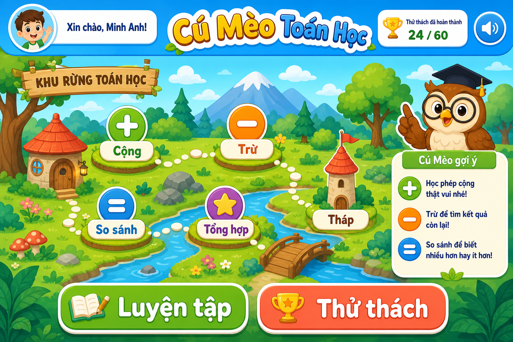
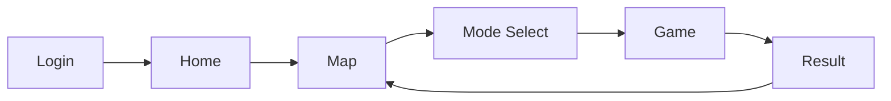

# Wireframe Và Visual Design - Cú Mèo Toán Học

## 1. Visual direction

Phong cách: `2D phẳng đơn giản`, vui tươi, rõ ràng, ít chữ, nhiều biểu tượng.

Concept chính: `Khu Rừng Toán Học`

- Nhà Cú Mèo: trang chủ.
- Cây Cộng Số: chủ đề cộng.
- Cầu Phép Trừ: chủ đề trừ.
- Suối So Sánh: chủ đề so sánh.
- Đỉnh Núi Tổng Hợp: màn tổng hợp.
- Tháp Thông Thái: thử thách nâng cao.

Concept image đã lưu tại:



## 2. Design tokens đề xuất

### Màu sắc

```css
:root {
  --sky: #8fd7ff;
  --leaf: #58b66b;
  --leaf-dark: #2f7d4b;
  --sun: #ffd766;
  --coral: #ff8a65;
  --wood: #b8794a;
  --cream: #fff8e7;
  --ink: #243447;
  --success: #36b66b;
  --danger: #f06464;
  --warning: #ffbf47;
  --card: #ffffff;
}
```

### Typography

- Font ưu tiên: `Nunito`, `Baloo 2`, hoặc fallback `system-ui`.
- Cỡ chữ nút tối thiểu: `18px`.
- Câu hỏi chính: `40px - 56px` desktop, `32px - 40px` mobile.
- Không dùng chữ quá mảnh.

### Shape

- Card: radius `8px`.
- Nút lớn: radius `12px - 16px`, vì dành cho trẻ nhỏ và thao tác chạm.
- Icon button: hình tròn hoặc vuông bo nhẹ, kích thước tối thiểu `44px`.

## 3. Wireframe tổng quan



## 4. Màn đăng nhập

Mục tiêu: học sinh vào game nhanh, không tạo cảm giác như đăng nhập phức tạp.

```text
┌────────────────────────────────────────────┐
│              Cú Mèo Toán Học              │
│                                            │
│                  (Cú mèo)                  │
│                                            │
│  Tên của con                              │
│  ┌──────────────────────────────────────┐  │
│  │ Minh Anh                             │  │
│  └──────────────────────────────────────┘  │
│                                            │
│  Con học lớp nào?                          │
│  [ Lớp 1 ]   [ Lớp 2 ]                     │
│                                            │
│              [ Bắt đầu ]                   │
└────────────────────────────────────────────┘
```

UX:

- Ô nhập tên lớn.
- Chọn lớp bằng segmented control.
- Cú mèo chào bằng một câu ngắn.
- Nếu đã có profile, hiện nút `Chơi tiếp`.

## 5. Màn Home

```text
┌────────────────────────────────────────────┐
│ Minh Anh   ⭐ 420   ✅ 4 thử thách   🔊    │
├────────────────────────────────────────────┤
│                                            │
│  Cú mèo: "Hôm nay mình luyện toán nhé!"    │
│                                            │
│  ┌──────────────┐  ┌──────────────┐        │
│  │ Luyện tập    │  │ Thử thách    │        │
│  │ Không áp lực │  │ 10 câu       │        │
│  └──────────────┘  └──────────────┘        │
│                                            │
│  Huy hiệu gần đây: [Cú Con Chăm Chỉ]       │
│                                            │
│              [ Vào Khu Rừng ]              │
└────────────────────────────────────────────┘
```

UX:

- Không làm landing page dài.
- Hành động chính nổi bật: `Vào Khu Rừng`.
- Hiện tổng điểm và số thử thách hoàn thành.

## 6. Màn bản đồ Khu Rừng Toán Học

```text
┌────────────────────────────────────────────┐
│ ← Trang chủ        Khu Rừng Toán Học  🔊   │
├────────────────────────────────────────────┤
│                                            │
│         [Cây Cộng Số]                      │
│              │                             │
│       [Cầu Phép Trừ]──[Suối So Sánh]       │
│              │                             │
│      🔒 [Đỉnh Núi Tổng Hợp]                │
│              │                             │
│      🔒 [Tháp Thông Thái]                  │
│                                            │
│  Cần hoàn thành thêm 4 thử thách để mở.    │
└────────────────────────────────────────────┘
```

UX:

- Node mở khóa có màu sáng, có icon.
- Node khóa giảm opacity và có ổ khóa.
- Điều kiện mở khóa hiển thị ngay khi chọn node khóa.

## 7. Màn chọn chế độ và độ khó

```text
┌────────────────────────────────────────────┐
│ Chủ đề: Cây Cộng Số                        │
├────────────────────────────────────────────┤
│ Chọn cách chơi                             │
│ [ Luyện tập ]   [ Thử thách ]              │
│                                            │
│ Chọn độ khó                                │
│ [ Dễ ]  [ Vừa 🔒 ]  [ Khó 🔒 ]             │
│                                            │
│ Kiểu trả lời                               │
│ [ Tự động ] [ Chọn đáp án ] [ Nhập số ]    │
│                                            │
│             [ Bắt đầu chơi ]               │
└────────────────────────────────────────────┘
```

UX:

- Mặc định `Tự động`.
- Dễ ưu tiên trắc nghiệm.
- Khó ưu tiên nhập đáp án.
- Màn khóa không cho chọn nhưng giải thích rõ điều kiện mở.

## 8. Màn chơi

```text
┌────────────────────────────────────────────┐
│ Câu 3/10     ⭐ 120        00:25       🔊   │
│ ███████████████░░░░░                       │
├────────────────────────────────────────────┤
│                                            │
│                 23 + 14 = ?                │
│                                            │
│         [ 35 ]     [ 37 ]                  │
│         [ 39 ]     [ 41 ]                  │
│                                            │
│  Cú mèo: "Cộng hàng chục trước nhé!"       │
│                                            │
└────────────────────────────────────────────┘
```

Trạng thái:

- Đúng: đáp án sáng xanh, hiện `+10`, cú mèo vui.
- Sai: nút rung nhẹ, màu đỏ/cam nhẹ, cú mèo suy nghĩ.
- Còn dưới 5 giây: timer đổi màu cảnh báo.
- Hết giờ: phát âm thanh ngắn, chuyển câu tiếp theo.

## 9. Màn nhập đáp án

```text
┌────────────────────────────────────────────┐
│ Câu 6/10     ⭐ 170        00:18            │
├────────────────────────────────────────────┤
│                                            │
│                 58 - 23 = ?                │
│                                            │
│              ┌────────────┐                │
│              │     35     │                │
│              └────────────┘                │
│                                            │
│              [ Trả lời ]                   │
└────────────────────────────────────────────┘
```

UX:

- Input chỉ nhận số với phép tính.
- Với so sánh có thể dùng 3 nút `>`, `<`, `=`.
- Trên mobile, input đủ lớn để chạm.

## 10. Màn kết quả

```text
┌────────────────────────────────────────────┐
│              Hoàn thành thử thách!         │
├────────────────────────────────────────────┤
│                    🦉                      │
│                                            │
│  Đúng: 8/10                                │
│  Điểm lượt này: 120                        │
│  Tổng thử thách: 5                         │
│                                            │
│  +20 điểm thưởng                           │
│  Huy hiệu mới: Cú Con Chăm Chỉ             │
│                                            │
│       [ Chơi lại ]   [ Về khu rừng ]       │
└────────────────────────────────────────────┘
```

UX:

- Có pháo giấy/sao khi hoàn thành tốt.
- Nếu mở khóa mới, hiện modal ngắn: `Đã mở khóa độ khó Vừa!`.

## 11. Asset cần chuẩn bị

### Linh vật cú mèo

Các trạng thái:

- `owl-idle`: bình thường.
- `owl-happy`: trả lời đúng.
- `owl-thinking`: sai/gợi ý.
- `owl-celebrate`: hoàn thành thử thách.
- `owl-timeout`: hết giờ.

MVP có thể dùng SVG/CSS đơn giản trong code. Nếu muốn đẹp hơn, tạo ảnh PNG/SVG riêng cho từng trạng thái.

### Background/map

- Forest background dạng 2D phẳng.
- Node chủ đề: cộng, trừ, so sánh, tổng hợp, tháp.
- Icon ổ khóa.
- Icon sao/huy hiệu.

### Âm thanh

- `startup-chime`
- `correct`
- `wrong`
- `timeout`
- `complete`

## 12. Responsive

Desktop:

- Map có thể hiển thị ngang/rộng.
- Game panel đặt giữa, mascot ở bên phải.

Tablet:

- Giữ layout giống desktop nhưng giảm khoảng cách.

Mobile:

- Một cột.
- Mascot nằm trên hoặc dưới câu hỏi.
- Nút đáp án full width hoặc grid 2 cột nếu đủ rộng.
- Không để text bị tràn khỏi nút.

